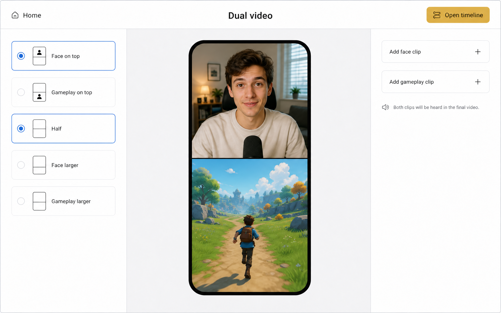

# Go7Flicks product bible

Baseline for the team. Updated 2026-11-07 from the local editor plan, the viral-video PDF, and the app in this repo. `TRAINING.md` is the short index. When a control is added or refused, change this file first, then the index.

The app is Electron, Vite, and React at `~/workspace/go7-flicks`. The window is the product. The renderer never starts ffmpeg or a Remotion encode. The main process does.

## 1. What the product is

Go7Flicks is a separate local app for Drew and Wes. Both of them run Windows. A person makes a channel folder, starts a flick from the ranking desk or the split desk, cuts it on the one canvas, and exports an MP4 on that computer. This Mac has the Mac package scripts and has not produced the Windows installer. Later, after both of them can do that on their own PCs, it may be a $10 a month app. That price is not real until the Remotion Automators minimum is checked. Local family use of Remotion fits the free license. A sold native app that renders for customers is the Automators license.

A channel is a folder. `channel.json` holds the name, the accent color, the media list, and the flick list. Each flick is `flicks/<id>/flick.json`. Copy the folder to the other PC or to a disk the other boy can open. There is no Go7Flicks account and no cloud project. Connections stay on the computer that saved them. Saved templates stay on that install. The flick’s canvas travels inside the channel, so the other PC opens the edit without the template library. Workhorse does not have to be running.

A template is the baseline, not a lock. The editor is a canvas. Start from a template or from blank. The person can change the layout and the cuts. Save as template stores the layout and the cuts and drops the media. Built-in templates are never overwritten. A template the person saved can be replaced, or saved again under a new name.

A pasted TikTok, YouTube, Instagram, Short, or Reel link is a note on a clip (`sourceUrl`). The app never downloads that video, never scene-detects it, and never sends it to a model. The picture has to already be a file on the computer. Add clip copies it into `media/`. Link clip keeps an absolute path for a large file that should stay where it is.

Go7Flicks copies Workhorse’s connection pattern and keeps its own encrypted keys. It does not open Workhorse’s saved secrets, and it does not print keys or dump env files.

It is not the desk. Workhorse stays the desk. It is not a browser NLE, and it does not buy or embed the Remotion Timeline component. The first timeline is ours, and it is small. It is not Viblo. Viblo’s public prices are about $25, $49, and $99 a month with credit caps. This app wins only if export is reliable on an ordinary Windows PC and the screen stays obvious.

The PDF at `~/Downloads/go7workhorse_viral_video_engine_spec.pdf` is right about the picture: a wizard first, a timeline second, Remotion for the vertical frame. It is wrong about living inside Workhorse, about downloading someone else’s short, and about `--codec=h264-videotoolbox` as the encode switch. The styled path uses `hardwareAcceleration: "if-possible"` and `videoBitrate: "8M"`, with `crf` set to null.

## 2. How a person uses it

This is the baseline. The two desks replace the dense tool list. There is one canvas, and it is the cut surface. There is no second editor.

1. **Home.** A white left rail and a light main area. The rail is Home, Library, and Connections. The greeting is “Hello, what would you like to create today?” Under it, three small pills: Quick, Full, and AI. The cards on that first screen are Video Ranking and Split. Those are the two starts. A kid can tell which one to click.
2. **Library, when a channel is needed.** Channel name, New channel, Open folder, and the recent folders. New channel asks for a parent folder and writes `channel.json`, `media/`, `flicks/`, and `exports/`.
3. **Channel.** The channel name, five accent swatches, Connections, New flick, and a card per flick. New flick asks for a name and a template. The choices that ship are Split screen, Dual video, Video ranking, and Blank. Blank is one full-frame region and an empty video track. Blank stays on this dialog. It is not a home card.
4. **Ranking desk, or split desk.** A phone in the middle. Open timeline is the only strong button. It writes the flick and opens the canvas.
5. **Canvas.** Seam, trim, split, delete, reorder, write line, make voice, export. That is the whole cut surface.
6. **Export.** The person picks where the MP4 goes. The top bar already shows the encoder name, or “software”.

### What leaves the first click

These cards are in the current home, and they come off that first screen. They stay later, until the thing they name actually exists. They do not get a second editor.

- **Auto Clipping.** The card says Clip It Now and opens a blank canvas. The scan that offers in-out points is not built. It stays off the first screen.
- **Text Story.** The card opens a blank canvas. A text-story desk is not built. It stays off the first screen.
- **Video Commentary.** The card already opens the split desk. Split is the start, so this card does not sit beside it.
- **Simple Editor.** The card opens a blank canvas. Blank stays on New flick, inside the channel.
- **Video Transcriber.** The button says Coming later. It stays off the first screen.
- **Generate Image**, and an AI video card if one is added. Still pictures and generated footage are not in this build. They stay off the first screen.
- **Generate AI Voiceover.** Voice is Make voice on the canvas, after a cut is selected. The home card that only opens Connections comes off the first screen. Connections stays on the rail.

The pills stay. Clicking Full or AI does not bring those later tools back onto the first screen.

### What is on each screen

**Home.** White rail, the greeting, three pills, two cards: Video Ranking and Split. The frames in section 4 show the light shell. The saved home frame still draws Auto Clipping, Video Commentary, and Text Story. Those three are the cards this baseline removes.

**Ranking desk.** Top bar: Home, “Video ranking”, Open timeline. Left rail: 5, 6, and 7, then one slot per rank, then the words Countdown, Listed, and Shuffle. Center: a 9:16 phone. The title is on the frame. The selected slot’s clip plays in the phone when a local file is added. A rank number sits on the frame when “Show the rank number” is on. The clip title sits under it with the stroke. Right side, one quiet inspector: video title, words to color, highlight color, stroke, the rank checkbox, Add clip, clip title, link note, in, out, Earlier, Later.

**Ranking desk.** Top bar: Home, “Video ranking”, Open timeline. Left rail: 5, 6, and 7, then one slot per rank, then Countdown, Listed, and Shuffle. Center: a 9:16 phone. The title is on the frame. The selected slot’s clip plays in the phone when a local file is added. A rank number sits on the frame when “Show the rank number” is on. The clip title sits under it with the stroke. Right side: video title, words to color, highlight color, stroke, the rank checkbox, Add clip, clip title, link note, in, out, Earlier, Later.

**Split desk.** This is the dual desk. Top bar: Home, Dual video, Open timeline. Left: Face on top or Gameplay on top, then Half, Face larger, and Gameplay larger. Half starts selected, with the face on top. Center: the phone, split by that seam. Right: the flick name, Add face clip, Add gameplay clip, and a sound switch for each clip. Both clips start heard. Open timeline writes the Dual video template.

**Canvas.** One cut surface. Top bar: Channel, the flick name, the encoder line, Export cut, Export styled. Center: the 1080×1920 frame and the seam. The selected cut has trim, split, delete, and reorder. Write line and Make voice sit on that cut. Bottom: Play and one lane per track. B splits at the playhead. Delete closes the gap. Save as template stays on this screen. Do not add a second editor beside it.

**Connections.** Back, a form, and one card per saved row. The form is kind, name, login, key, model, base URL, and format. The card shows Connected or Not tested, and Test, Edit, and delete. A key field is a password field. The renderer is told that a key is saved. The key itself stays in this app’s encrypted store.

**Channel** is the list of flicks, described above.

### Descriptions after the Codex Terra pass

Codex Terra reviewed these five paragraphs on 2026-11-07 through `~/.local/bin/codex-api-call --model gpt-5.6-terra --effort low`. The caller reported model `gpt-5.6-terra`, status completed. The shorter wording below is what we kept.

**Home.** Hello, what would you like to create today? Choose Quick, Full, or AI. Start a ranking or a split. Library holds the channel folders. Connections is where you choose who writes a line.

**Ranking.** Rankings use a phone frame and numbered slots. The title sits on the frame. A return starts the second line. Named words take the highlight color. Stroke is the black outline. Start with five slots. Six and seven use the same control. Countdown plays 5, then 4, then 3. Listed plays the rail order. Earlier and Later move a slot. Shuffle changes the play order and leaves the rank numbers where they are. Open timeline writes that order onto the canvas.

**Split.** Split Screen is the dual desk. A face or a UGC clip sits on one half and gameplay on the other. Half is the start. Face larger gives the face 60%. Gameplay larger gives the gameplay 60%. Either clip can be on top. Move the seam on the timeline. Both clips are heard unless a sound switch is off. Add the two files from this computer, then open the timeline.

**Export.** Export cut uses ffmpeg. Matching clips are copied. Clips that need scale or crop are encoded with the probed encoder, VideoToolbox, NVENC, QSV, or AMF, at 8M. Export styled uses Remotion to draw the split and the titles, then encodes with hardware acceleration when the machine has it, at 8M. Styled export sets `crf` to null. The window shows the encoder name before the render starts. When only software encoding is available, the window says software.

**Connections.** Each account has its own row: Claude, Codex, ElevenLabs, MiniMax, or Other. Choose the row when you write a line or make a voice. There is no automatic router and no usage ring. Keys stay encrypted in this app. This app cannot open Workhorse’s saved secrets. A pasted TikTok, YouTube, or Instagram link is a note. The video has to already be a file on this computer.

Terra also wanted the `crf` sentence and the probed-encoder wording removed as implementation detail. Those stay. They are product rules, and a later edit that puts `crf` back on the styled path would be a bug. The on-screen greeting stays because that sentence is what the home page shows. “Writes that order onto the canvas” stays because Open timeline saves the clips in that order.

## 3. Feature list

Status words: **in the app**, **next**, **refused**. The first screen in section 2 is the baseline even where the current home still shows a later card.

### First screen

- **In the app.** The light shell: white rail, greeting, three pills, Library, Connections.
- **Baseline.** Two cards only: Video Ranking and Split. Open timeline on that desk is the handoff to the canvas.
- **Next, and off the first click.** Auto Clipping, Text Story, Video Transcriber, Generate Image, Generate AI Voiceover, Simple Editor, and Video Commentary as its own card. The work they point at is still listed under those names below. None of them become a second editor.

### Channels and library

- **In the app.** New channel, open a folder, recent channels on Library, accent color, flick cards, the folder layout above.
- **In the app.** Add clip copies into `media/`. Link clip stores an absolute path. A missing linked file shows as missing on the canvas.
- **Next.** A library of finished exports inside the app. Today the MP4 is whatever path the save dialog returned, and the channel has an `exports/` folder ready for that.
- **Refused.** A Go7Flicks account, a cloud project, and opening Workhorse’s channel or secret store.

### Canvas and templates

- **In the app.** Four built-ins in `builtinTemplates()`: `builtin-split` (top 60 / bottom 40, hook, beat, payoff, muted loop), `builtin-dual` (half / half, face and gameplay, both heard), `builtin-ranking` (five rank slots plus a muted loop), `builtin-blank` (one region, no clips). `flickFromTemplate` copies the recipe onto the flick and leaves the original template alone.
- **In the app.** Drag the seam (`dragSeam`), Full frame, Split evenly, trim in and out, split at the playhead, delete closes the gap, reorder with Earlier and Later. Undo and redo keep the last 30 canvas edits in the window. Cuts stay on that flick.
- **In the app.** Save as template (`templateFromFlick`) keeps regions, tracks, and cut lengths, sets `mediaId` to null, and drops the link, the music file, and the music credit. Replace is offered only for templates the person saved. Built-ins are not in that menu.
- **In the app.** Add music copies one local audio file into the channel. A credit is optional and is removed with that file. The credit is drawn on Export styled and on Export cut when the music is in that file. Files already added on this computer are kept in a shelf and can be used on the next flick. The app does not download music.
- **In the app.** Preview is `@remotion/player` in the window. Frame is 1080×1920 at 30 fps (`FRAME` in `src/shared/model.ts`).
- **Next.** Text-story and chat-story templates. Commentary as a script that becomes scenes, instead of only opening the split desk.
- **Refused.** Buying or embedding the Remotion Timeline component. Treating a template as a lock.

### Video ranking

- **In the app.** Multiline title on the frame. A return starts the second line. Named words, comma-separated, take the highlight color. Stroke width from 0 to 12. Rank number shown or hidden for every slot together.
- **In the app.** One slot per rank. Each slot takes a local clip, a short clip title, in and out, and a link note. Default is five slots. Six and seven are the same control. New slots are numbered from the top of the list downward, so five slots start at #5.
- **In the app.** Playback is Countdown, Listed, or Shuffle. Countdown sorts by rank, high to low, so the film plays 5 then 4 then 3. Listed keeps the rail. Earlier and Later move the selected slot on that rail. Shuffle runs `shuffleIds` and stores the id list. Pressing Shuffle again rolls a new order. Rank numbers stay on the slots. The rail shows “Play 1”, “Play 2”, and so on. Open timeline writes the clips onto `track-top` in that play order. The clip label is `#` plus the rank when the number is shown, otherwise the clip title. The spoken line is the clip title. `playbackOrder` in `src/shared/canvas.ts` is the rule.
- **Next.** Fade-in and bounce on the clip title. Drag the clip title so it sits under the headline. Edit one slot’s number on its own. A black plate behind the headline, separate from the stroke.
- **Next.** Auto clipping inside a ranking: pick a long local file and offer a few in-out candidates. That scan stays on this machine.

### Split layouts

- **In the app.** The Split Screen card opens the dual desk. See Dual video. `builtin-split` still ships on New flick: top 60 / bottom 40, hook, beat, payoff, and a muted bottom loop. Full frame and Split evenly stay on the canvas.
- **In the app, off the first screen.** Video Commentary opens this same dual desk. The separate card stays in Later. A script that becomes scenes is next, and it still opens this canvas.
- **Next.** PiP, feathered dividers, and a speed ramp on the bottom loop. Those are in the PDF. They wait until the two-region split is the one the boys actually use.

### Dual video

A reusable half-and-half template. The top half starts as the face or the UGC clip. The bottom half starts as the gameplay. Swapping them is the same template. It can be any game. Both pictures are files already on the computer. A pasted link stays a note and is never downloaded.

Drew or Wes opens Split Screen on the home. That card is this desk, and it is still one of the two first-screen cards. Half is already selected, with the face on top. They choose Face on top or Gameplay on top, and a seam preset before Open timeline: Half (0.5 / 0.5), Face larger (the face region is 60%), or Gameplay larger (the gameplay region is 60%). They add the two local files. Open timeline writes a flick from `builtin-dual`. On the canvas they drag the seam with `dragSeam`. Save as template stores that layout for the next flick and leaves the built-in alone.

Both tracks start unmuted. The phone on the desk plays a side when that side is heard. The timeline and Export styled play both clips under the voice. Each clip has a sound switch, so turning one off is the mute. Export cut still concatenates the top region and drops clip audio. Its sound is the voice and any added music.

- **In the app.** `builtin-dual` in `builtinTemplates()`: two regions at 0.5 and 0.5, clips Face and Gameplay, tracks `track-face` and `track-game`, both unmuted. `applyDualLayout` writes the arrangement and the preset onto the flick. The seam still moves after Open timeline.
- **In the app.** The home card stays Split Screen. Its copy says face and gameplay. Later tools stay off the first screen.
- Concept frame: `docs/concepts/dual-video.png`.

### Auto clipping

- **In the app, off the first screen.** The Auto Clipping card opens a blank canvas named Clip. Hand cuts on that canvas already work. The card comes off the home.
- **Next.** A local scan that offers a few in-out candidates, used from the ranking desk. That scan stays on this machine. It does not become its own editor.
- **Refused.** Detecting scenes on someone else’s downloaded video.

### Text, captions, and kinetic type

- **In the app.** The ranking headline, the highlight words, the stroke, the rank numeral, and the clip title or spoken line drawn by `FlickComposition`. On the canvas, the line is a text field on the selected cut.
- **In the app, off the first screen.** Text Story opens a blank canvas. That card comes off the home. The line stays on the canvas.
- **Next.** Kinetic captions, emoji pops, a black plate, fade and bounce, word-level captions, and a caption lane that can delete a word.
- **Next.** Video Story and Text Story as their own desks, including a chat or card layout. The PDF’s iMessage, Reddit, and comment-ladder rigs live here, still without downloading a source video.
- **Refused.** Sending a pasted social link, or the video behind it, to a model so it can invent captions.

### Transcription

- **In the app.** Nothing that transcribes. The Video Transcriber card says “Coming later”, and it comes off the first screen.
- **Next.** Word-level captions from a local whisper build. NVIDIA Windows uses CUDA. Mac uses Metal. The transcriber card waits on a build that actually runs. `/opt/homebrew/bin/whisper` is openai-whisper and, on 2026-11-07, it fails at import because PyTorch cannot load `libabsl`. Do not call it from the app until that import works. There is no `faster-whisper` binary on this Mac.
- **Refused.** Uploading the boys’ footage, or anyone else’s, to a hosted transcription API as the default. A hosted call is allowed only when the person picked that connection for a line they typed.

### Voice

- **In the app.** Make voice on the canvas, for the clip under the playhead. The person picks an ElevenLabs or MiniMax row. The file is `flicks/<id>/voice.mp3`. The styled composition plays it at full level and keeps heard clip audio. Added music plays at 0.22, or at 0.10 while the voice file is present. The cut export muxes the voice and the music under the picture and still drops clip audio. Connections on the rail is where the key is saved and tested. The Generate AI Voiceover home card comes off the first screen.
- **Next.** A voice picker with a short preview on the desk, before the timeline. Two voices on one flick, for a chat story.

### Rendering

- **In the app.** Startup of the canvas calls the GPU probe and writes one line: the encoder name, or “software”, or “ffmpeg missing”.
- **In the app.** Export cut (`electron/cut.ts`). The top visible region’s clips are trimmed and concatenated with the probed ffmpeg. A clip that is already H.264 at 1080×1920 is stream-copied. Anything else is scaled and cropped, then encoded. Hardware encoders use `-b:v 8M`. The software fallback `libx264` uses `-preset veryfast -crf 20` on this cut path only. VideoToolbox, NVENC, QSV, and AMF are the probe order that can win. On this Mac the preference is VideoToolbox, then libx264. On Windows the preference is NVENC, then QSV, then AMF, then libx264. Remotion cannot use QSV or AMF. That is why the cut path exists.
- **In the app.** Export styled (`electron/styled.ts`). `renderMedia` uses `codec: "h264"`, `hardwareAcceleration: "if-possible"`, `videoBitrate: "8M"`, and `crf: null`. Mac uses VideoToolbox when the encoder allows it. Windows with NVIDIA uses NVENC. Anything else is software x264, and the encoder line has already said software. The styled picture includes the split, the headline, the rank, the line, the voice file, and the music credit when one is set. A region plays its own clip audio unless that track is muted. A voice file does not mute it.
- **In the app.** Mac dmg scripts are in `package.json` (`pack:mac`, `package:mac`, `dist:mac`, arm64). Windows scripts are in the same file: `pack:win`, `package:win`, `dist:win`, app id `com.go7studio.flicks`, NSIS installer `release/Go7Flicks-Setup-0.1.0.exe`. This Mac has not run that build. Drew and Wes run it on their own PCs. The steps are in section 9 and in `WINDOWS.md`.
- **Refused.** A `crf` setting on the styled path. It silently falls back to software x264. A Mac-only `--codec=h264-videotoolbox` flag as the product switch.

### Connections

- **In the app.** Claude, Codex, ElevenLabs, MiniMax, and Other. Each row is one account. Test runs before the row is marked connected. A failed test leaves it disconnected and does not start a render.
- **In the app.** Claude can use the subscription helper already on this Mac, or a pasted Anthropic key. Codex can use the Codex CLI already on this Mac, or a pasted OpenAI key. ElevenLabs is a speech key. Test lists voices. MiniMax uses `https://api.minimax.io/v1` for lines and `/t2a_v2` for speech when that key is allowed to speak. Other is a base URL, a key, and either `anthropic-messages` or `openai-completions`.
- **In the app.** Write line sends the channel name, the layout, and the clip label to the chat row the person picked, and writes the returned sentence onto that clip. The prompt asks for one spoken line and nothing else.
- **Next.** Grok, Cursor, and Gemini as their own rows. Until those rows exist, a key for a host that speaks Anthropic or OpenAI format goes in Other.
- **Refused.** An auto-router. A usage ring. Pooling every key into one shared token. Reading Workhorse’s `credentialId` store.

### Export sizes

- **In the app.** One size. 1080×1920, 30 fps. That file is the Short, the Reel, and the TikTok. There is no size menu.
- **Next.** Another aspect ratio, 60 fps, or a 4K master. The PDF asks for 4K/60. That waits until 1080×1920 export is boring and reliable on both boys’ machines. Adding sizes before that spends the machine the preview needs.

### Performance budget

The numbers and the rules are in section 5. The budget is a feature: the UI stays cheap enough that a video preview and a background encode can share the machine.

## 4. UI principles

Locked 2026-11-07 to the frames Steve approved: `docs/concepts/home.png` (the light shell) and `docs/concepts/ranking.png` (the ranking desk). Quick Editor’s first screen is two cards only: Video Ranking and Split Screen. Dual video is the Split Screen desk, not a third home card. The presets are Face on top, Gameplay on top, Half, Face larger, and Gameplay larger. Both clips can be audible. Open timeline is gold. Auto Clipping, Video Commentary, Text Story, Video Transcriber, and Generate Image stay in the rail under Later. They are not the first click.

This layout is the baseline. It replaces the dense tool list. Minimal. One obvious next step. Low chrome. A kid can tell which button moves the work forward.

- **Home.** One greeting, three small pills, and two large cards on Quick Editor: Video Ranking and Split Screen. Lots of empty space. Library and Connections stay on the white rail. Later tools stay listed as later. They are not the first click.
- **Ranking desk and split desk.** The two starts. The ranking desk is a multiline headline, accent words, rank on or off, 5, 6, or 7 slots, and Countdown, Listed, or Shuffle. Shuffle mixes play order and does not rewrite rank. Split Screen is the dual desk: Face on top, Gameplay on top, Half, Face larger, and Gameplay larger, and both clips can be audible. Each desk is a phone, a short list, and one quiet inspector. Open timeline is the gold button, and it is the handoff to the canvas.
- **Canvas.** The cut surface, and the only editor. Seam, trim, split, delete, reorder, undo, write line, make voice, add music, export. On a flick with two or more visible regions the cut button says “Export cut · keeps the top picture”. With one visible region it says “Export cut”. Cut sound is the voice and the music. Export styled draws both halves, titles, voice, heard clip audio, and the music credit. There is no bundled song catalog and no second encode format. Files already added stay on this computer and can be used again. Styled stays `hardwareAcceleration: "if-possible"`, `videoBitrate: "8M"`, and `crf` null. A pasted link remains a note. The app does not download a TikTok, YouTube, or Instagram video. Speed curves, face tracking, smart crop, SFX lanes, and a second timeline product stay off this screen.
- **Connections.** A short form and a list of rows. Test is the next step.
- **Channel.** A list of flicks plus New flick. Blank is chosen here.

Quick Editor’s first screen is already those two cards. Auto Clipping, Text Story, Video Commentary, Simple Editor, Video Transcriber, Generate Image, and Generate AI Voiceover stay later, listed in section 3. They are not the first click. The PDF’s CapCut deck is not added beside this canvas.

### Concept frames

Lovart returned both frames on 2026-11-07 after `lovart_confirm` with credit spend approved. Each thread had been waiting on a 15-credit confirm. Both confirms returned `done` and a PNG. The files on disk:

- Home: `docs/concepts/home.png` (2048×1280). Thread `75f9bb52-c3a1-4a21-8284-826897399a63`. White rail, the greeting, three pills, and four cards. Use the light shell. The saved frame still draws Auto Clipping, Video Commentary, and Text Story. The app’s Quick Editor does not. Those stay later, as section 2 says. Split Screen is the second start, and dual video is that desk, not a third home card. The frame drew that start under the name Video Commentary.
- Ranking: `docs/concepts/ranking.png` (2048×1280). Thread `3efa1f4b-03be-4356-942d-c51bad761be3`. This is the ranking desk: 9:16 phone, title on the frame, rank slots, Countdown / Listed / Shuffle, one inspector, Open timeline.

Dual video, generated 2026-11-07. Lovart thread `3b227893-8d9c-4230-a896-ce26abb7a03b`. `lovart_confirm` approved a `generate_media` step priced at 17 credits. The call returned `done` and this PNG. The ranking frame above stays the lock. This frame is the dual desk only: white chrome, one gold Open timeline button, a 9:16 phone split in half, face on top, gameplay below, and the seam presets beside it.

## 5. Performance budget

Create and save of the project files stay on the UI only as small JSON. Video work and model work stay off that thread.

Checked once on 2026-11-07 with `npx tsx --test test/create-save.perf.test.ts` (`test/create-save.perf.test.ts`). The test makes a temp channel, a blank flick, and a ranking flick, saves them, checks the files, and deletes the temp folder. No network. No video. No app user-data.

| Step | Time |
| --- | --- |
| Create the channel, the blank flick, and the ranking flick, including the first save | 2.0 ms |
| Save both flicks again | 0.5 ms |
| The test body | 4.6 ms |
| The process, including tsx startup | 134.4 ms |

The ranking flick had 6 clips and no media. The blank flick had 0 clips. A few milliseconds is the budget for this path. A number in the hundreds of milliseconds on a later run means create or save started doing I/O it should not do.

What stays cheap:

- **Idle UI.** Home, Library, the channel list, and both desks are local React state. They do not start ffmpeg, Remotion’s renderer, whisper, or a model.
- **Preview.** `@remotion/player` scrubs in the window. It is not an encode. Ranking plays the selected clip. Split plays a side when that side is heard. They do not mount the player until Open timeline. Music is heard on the canvas.
- **Save.** The canvas writes `flick.json` after a 350 ms pause. That write is the same shape as the timing test.
- **API.** Write line is one short call, and only after the person presses the button and picks the row. Claude on this Mac uses cache none for that one-off line. No usage polling, no background router.
- **Background render.** One export at a time. The buttons wait on the main-process IPC. Cut is ffmpeg. Styled is Remotion plus the encode, and it is the heavy one. Do not start the other export while one is running. Do not start a second preview render beside the player.

How they share the machine:

- The player and a styled render both want the GPU. The player is already on screen. The render should be the only new encode. Leave headroom so the machine can still load the next video and keep the window moving.
- The cut path is the one that can use a Windows iGPU or an AMD card. Prefer it when the flick is a straight concat and does not need the drawn title.
- The GPU probe runs when the canvas opens, once. It does not re-probe on every keystroke.

What we will not do on the UI thread:

- ffmpeg encode or concat
- `renderMedia`
- whisper, scene detection, or a file scan that offers in-out candidates
- provider HTTP, including Write line and Make voice
- reading or writing secret files
- hashing or walking a NAS share

Those belong in the main process, or in a worker the main process starts. The renderer asks and waits.

## 6. Wiring Workhorse’s callers without merging

Workhorse stays a different app. Go7Flicks does not import it, does not read its user data, and does not resolve a Workhorse `credentialId`. The pattern to copy is: a subscription CLI that is already logged in on the computer, or a key stored with this app’s own `safeStorage`.

### What Go7Flicks already calls

`electron/providers.ts`

- `testProvider`, `writeLine`, `synthesize`
- `runCli` for a Claude or Codex row whose login is “Subscription already on this computer”
- `testAnthropic` and `testOpenAI` for a pasted key
- `testEleven` and the ElevenLabs speech POST
- the MiniMax `/t2a_v2` speech POST

`electron/vault.ts`

- `saveSecret`, `readSecret`, `hasSecret`, `deleteSecret` under this app’s `userData/secrets`
- `encryptionReady` checks `safeStorage` before a key is written

Claude on this Mac already goes through `/Users/venomspike/.local/bin/anthropic-call`. Keep that. `runCli` calls it when the file exists:

`anthropic-call --account auto --model haiku --effort low --max-tokens 80 --cache none -- <prompt>`

`--account auto` follows the helper’s saved priority. That priority is secondary, then primary. Cache stays `none` for a one-off line. Go7Flicks does not open the helper’s key file. The helper does.

Codex on a subscription row currently calls `codex exec --skip-git-repo-check <prompt>` via `findBin("codex")`. On this Mac that binary is `/Users/venomspike/.local/bin/codex`. The call does not pass `--model`, so the CLI’s own default model is what answers.

### What Workhorse actually uses

Read these. Do not ship them inside Go7Flicks.

- `Go7-Workhorse-github/src/lib/providers.ts`: `PROVIDERS`, `providerById`, `isProviderId`. Codex is “Codex CLI via ACP” and uses the existing Codex login.
- `Go7-Workhorse-github/src/lib/types.ts`: `ProviderId` includes `codex`. A custom bot stores `credentialId` and an `api` of `anthropic-messages` or `openai-completions`. The desk resolves that id in its own encrypted store.
- `Go7-Workhorse-github/electron/codex-launch.ts`: `buildCodexLaunchSpec`, `resolveCodexModel`, `resolveCodexEffort`, `codexSpawnArgs`. The default model in that file is `gpt-5.6-sol`. A chosen slug such as `gpt-5.6-terra` is passed through. Effort is `model_reasoning_effort` inside `CODEX_CONFIG`, not a `--reasoning-effort` flag.
- `Go7-Workhorse-github/electron/codex-host.ts`: `spawnCodexProcess`, `CodexSessionHost`. This spawns `@agentclientprotocol/codex-acp` for a desk session.
- `Go7-Workhorse-github/electron/codex-login.ts`: `resolveCodexAcpLaunch`. The package name is `@agentclientprotocol/codex-acp`.

That ACP session is the right shape for the desk. It is the wrong shape for Write line. A one-sentence caption should stay a short CLI or API call.

### Codex Terra, and the caller to use for a line

No binary named Codex Terra, terra, or codex-terra exists under `~/bin` or `~/.local/bin`. The search there found `codex`, `codex-api-call`, `codex-session-finish.py`, and `codex-session-storage.py`. Under `~/.openclaw` and the Workhorse repo, Terra is the model id `gpt-5.6-terra`.

Two callers already know that id. Both were found. Neither key was printed.

- Saved API, used for the language pass in this bible: `/Users/venomspike/.local/bin/codex-api-call --model gpt-5.6-terra --effort low`. It POSTs to `https://api.openai.com/v1/responses` with the key it already has (`CODEX_API_KEY`, or its dedicated secrets file, then `OPENAI_API_KEY`). `gpt-5.6-terra` is in that account’s model list, along with `gpt-5.6-sol`, `gpt-5.6-luna`, and `gpt-6.1-terra`. The alias `codex` in that script means `gpt-6.1-sol`, so a Terra review has to pass the full model id.
- Subscription CLI, used by the Qualora pipeline: `openai_generate_via_codex` in `~/.openclaw/workspace/skills-lms-pipeline/scripts/openai_client.py`. It runs `codex exec --model gpt-5.6-terra --json --skip-git-repo-check`, and for a read-only question it adds `-s read-only` and `-c model_reasoning_effort=low`. Retired model names in that file map onto `gpt-5.6-terra`. It uses the Codex CLI login in `~/.codex/auth.json`. It does not use the Responses API key.

Recommended wiring for the Codex row in this app:

- Subscription login: change `runCli` so the row’s model is `codex exec --model <model> --skip-git-repo-check`, with `-c model_reasoning_effort=low` for Write line. When the person wants Terra, the model field is `gpt-5.6-terra`. Do not spawn `codex-acp` for that button.
- Pasted key: keep `testOpenAI` and this app’s vault. The person picks the row. The key never goes in the channel folder.
- Do not point Go7Flicks at `codex-api-call`’s secrets file, and do not point it at Workhorse’s `credentialId` files. `codex-api-call` remains the machine tool for a one-off review like the one in this bible. The app has its own store.
- Do not add an auto-router, and do not call Workhorse’s `routing.ts`.

MiniMax and ElevenLabs stay as they are in `synthesize`. Other remains the slot for a Grok, Cursor, or Gemini host until those kinds get their own rows.

## 7. Auto clipping, text, transcription, and rendering

### Auto clipping

Intended behavior. The person picks a long file that is already on the computer. The app offers a few in and out points. The person accepts or moves them. The scan uses audio energy or a local scene cut on that file, then the ranking or the canvas stores the points. Nothing is uploaded. A URL in the link field is ignored by the scanner.

Prebuilt. Hand cuts on the blank canvas, and in/out fields on the ranking desk. `splitClip`, `trimClip`, and `deleteClip` already close gaps.

Still to build. The candidate scan, and a desk that shows the candidates before Open timeline. The home card can keep opening the blank canvas until that exists, and its sentence should say so.

Local-only. The file path stays on this machine. No `yt-dlp`. No PySceneDetect on a downloaded reference, which is what the PDF’s `cloner_ingest.py` does. That script is refused.

### Text overlays

Intended behavior. A title on the frame, a few words in the highlight color, a stroke, a rank number, and one spoken line on the active cut. Kinetic captions, emoji, and a black plate come after the line is reliable.

Prebuilt. `FlickComposition` draws the headline, the highlight, the rank numeral from a label like `#5`, and the line or the label as the caption. The ranking desk has the same title treatment on the phone. The canvas has the line field and Write line.

Still to build. Motion, per-word timing, emoji, the plate, and dragging the clip title. Word timing depends on transcription.

Local-only. Write line sends the label and the layout, not the video bytes. The model never receives the file.

### Transcription

Intended behavior. A local whisper build returns words with times. The caption layer uses those times. CUDA on NVIDIA Windows, Metal on Mac. The person can turn it on from the transcriber card. Until the binary runs, the card stays a banner and the line is typed.

Prebuilt. The card and the banner. A broken Homebrew whisper at `/opt/homebrew/bin/whisper`. No working local timestamp path is wired.

Still to build. A main-process call that only runs after the import works, writes word times onto the flick, and never blocks the UI thread.

Local-only. Footage is not the body of a chat request.

### Rendering

Intended behavior. Two buttons, already named in section 3. Cut is the fast path when the clips can be concatenated and the drawn title is unnecessary. Styled is the path when the split, the title, and the voice have to be in the picture. The encoder line is visible before either button is pressed. One export runs at a time.

Prebuilt. `probeGpu` and `chooseEncoder` in `electron/probe.ts`. `exportCut` in `electron/cut.ts`. `renderFlick` in `electron/styled.ts`. A bundled `ffmpeg-static` for the cut path. Remotion keeps its own ffmpeg for the styled path. `scripts/verify-export.ts` is the existing export check. This bible’s timing test does not run it, and it is not a render marathon.

Still to build. The Windows NSIS package on a Windows PC, so NVENC, QSV, and AMF are proven on the boys’ machines. The Mac package cannot prove those encoders.

Local-only. Output is an MP4 the person chose. No upload step.

## 8. Open decisions and the order to build next

Nothing in the “next” list above is dropped. The order is the one that keeps the screen obvious and the machine usable.

The first screen is already simplified. Quick Editor is two cards only: Video Ranking and Split Screen. Dual video is the Split Screen desk, not a third home card. Presets are Face on top, Gameplay on top, Half, Face larger, and Gameplay larger. Both clips can be audible. Open timeline is gold. The ranking desk keeps a multiline headline, accent words, rank on or off, 5, 6, or 7 slots, and Countdown, Listed, or Shuffle. Shuffle mixes play order and does not rewrite rank. On a flick with two or more visible regions the cut button says “Export cut · keeps the top picture”. With one visible region it says “Export cut”. Export styled is unchanged and is the render that draws both halves, titles, and voice. There is no second encode format. Styled stays `hardwareAcceleration: "if-possible"`, `videoBitrate: "8M"`, and `crf` null. A pasted link remains a note. The app does not download a TikTok, YouTube, or Instagram video. Last test, on 2026-11-07, is that baseline. Later tools stay in the list below. They are not the first click.

1. **Codex model on the subscription row.** Done. Write line passes the row model into `codex exec` at low effort. An empty model field uses `gpt-5.6-terra`. The vault stays the only key store. A live caption still needs a Codex row in this app’s Connections. Do not read the `codex-api-call` secrets file.
2. **Local in-out scan.** Quick Editor already shows Video Ranking and Split Screen, and the later tools are not the first click. Next is the local in-out scan inside the ranking desk, for a file already on the machine.
3. **A whisper that runs.** Fix or replace the broken local whisper before the transcriber card does anything. Word times land on the flick from the main process.
4. **Ranking polish.** Fade and bounce, drag the clip title under the headline, a number on one slot, a black plate behind the headline.
5. **Story desks.** Commentary that turns a script into scenes. Text-story and chat-story templates. Video Story as its own card.
6. **Caption motion and the rest of the PDF’s timeline toys.** Kinetic captions, emoji pops, silence strip, speed curves, face tracking, smart crop, SFX lanes. After word times exist. Still no Remotion Timeline purchase, and still no downloader.
7. **Grok, Cursor, and Gemini rows.** Until then they stay in Other. No auto-router and no usage rings.
8. **Windows package.** Drew or Wes runs `npm run dist:win` on his own PC. This Mac has not built it. Confirm the encoder line there. Steps are in section 9.
9. **The $10 month.** Only after both boys can make a channel on their own PCs, and only after the Remotion Automators minimum is the number in front of the price. AI Image Generator and AI Video Generator stay next, and they stay out of the build until the clips the boys already have are easy to cut.

Still refused, in that same future: downloading or cloning someone else’s TikTok, Short, Reel, or YouTube video, scene-detecting that download, sending that video to a model, embedding the Remotion Timeline, setting `crf` on the styled export, and opening Workhorse’s secret store.

## 9. Drew and Wes on Windows

Both boys run Windows. This Mac cannot build the NSIS installer, and it has not. No Windows build has been run from this checkout. The short steps they follow are also in `WINDOWS.md`.

What is already in the repo, in `package.json`:

- `npm run pack:win` builds the app and writes an unpacked Windows folder with `electron-builder --win --dir`.
- `npm run package:win` runs `electron-builder --win nsis --publish never`. It expects `npm run build` to have finished first.
- `npm run dist:win` is the command to use. It runs the build, then `package:win`.
- App id: `com.go7studio.flicks`. Product name: Go7Flicks. Executable name: Go7Flicks.
- NSIS is not one-click. It is per user, it can change the install folder, and it adds a desktop shortcut and a Start menu shortcut. Uninstall does not delete app data.
- The installer file the script is set to write is `release/Go7Flicks-Setup-0.1.0.exe`. That file is not in this repo from a Windows run. Wine is not installed on this Mac, so this checkout did not produce the exe.
- The Windows icon is already `build/icon.ico`. `package.json` sets `build.win.icon` to that file. `build/icon.svg`, `build/icon.png`, and `build/icon.icns` are in the repo for the Mac package.

Drew, on his PC: install Node, clone `https://github.com/SteveMLC/go7-flicks.git`, run `npm install`, then `npm run dist:win`. Run `release\Go7Flicks-Setup-0.1.0.exe` and open Go7Flicks. Library, New channel, pick a folder on that PC. From home, open Video Ranking or Split, add clips that are already on the PC, then Open timeline. The encoder line on the canvas should read `h264_nvenc`, `h264_qsv`, `h264_amf`, or `software (libx264)`. Export cut or Export styled. Styled export uses Remotion `hardwareAcceleration: "if-possible"`, 8 Mbps, and no crf. On this Mac that encoder is `h264_videotoolbox`. On Windows with NVIDIA it is `h264_nvenc`. Intel QSV and AMD AMF are not in Remotion's styled path. A pasted TikTok, YouTube, or Instagram link is only a note. The app does not download it.

Wes, on his PC: the same steps, with his own install. He can use an installer file Drew already built, copied onto Wes’s machine, instead of running `dist:win` again. His Connections and his saved templates stay on his install. Drew’s stay on Drew’s.

One channel folder can be copied from one PC to the other. The other boy uses Open folder. The flicks come with the folder. Connections and templates do not.

## Where the code lives

| Piece | Path |
| --- | --- |
| Home, ranking, split, canvas, channel, connections | `src/ui/` |
| Frame, clips, connections model | `src/shared/model.ts` |
| Templates, cuts, playback order | `src/shared/canvas.ts` |
| Styled picture | `src/remotion/FlickComposition.tsx` |
| Keys | `electron/vault.ts` |
| Claude, Codex, ElevenLabs, MiniMax, Other | `electron/providers.ts` |
| Channel files | `electron/library.ts` |
| GPU probe | `electron/probe.ts` |
| Cut export | `electron/cut.ts` |
| Styled export | `electron/styled.ts` |
| Create and save timing | `test/create-save.perf.test.ts` |
| Home concept | `docs/concepts/home.png` |
| Ranking concept | `docs/concepts/ranking.png` |
| Dual video concept | `docs/concepts/dual-video.png` |
| Drew and Wes steps | `WINDOWS.md` |

## Last test

2026-11-07. Drove the running Electron app on port 9223 through home, the ranking desk, the split desk, and the canvas. Cut export 192 ms (top picture). Styled export 3784 ms, encoder h264_videotoolbox, 1080×1920, 30 fps, about 1 second, both pictures and audio. A fake TikTok link was stored on a clip and was not fetched.
